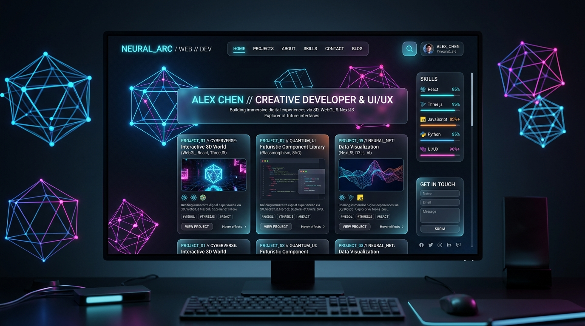

# 🌌 3D Interactive Developer Portfolio — Sai Kiran Ketha



An ultra-modern, high-performance 3D interactive developer portfolio for **Sai Kiran Ketha** — Full Stack Developer, Computer Science Engineering Undergrad at Swarnandhra College, and NxtWave CCBP 4.0 Fellow.

---

## 🚀 Live Demos
- **CCBP Live**: [https://kethasaikiran.ccbp.tech](https://kethasaikiran.ccbp.tech)
- **GitHub Pages**: `https://saikiranketha.github.io` *(upon deployment)*

---

## ✨ Features

- **3D WebGL Background**: Built with Three.js featuring 650+ reactive particles and floating geometric wireframe polyhedrons (Icosahedron, Torus Knot) rendered at 60 FPS.
- **3D Card Perspective Tilt**: Real-time perspective transforms on hover with specular lighting reflections.
- **Curriculum Vitae & Resume Explorer**: Tabbed view for Education, Experience & Fellowships, 10+ Certifications, and Core Competencies with a printable CV modal.
- **Featured Projects & Case Studies**:
  - 🎓 **Smart Attendance System**: Full-stack attendance platform with facial biometric recognition and analytics.
  - 👁️ **VisionX AI Solution**: AI computer vision surveillance analytics and real-time telemetry.
  - ⚡ **CCBP Full-Stack Web Suite**: Production-level web applications with REST APIs and SQLite persistence.
  - 🌌 **Next-Gen 3D Cyber Portfolio**: High-performance WebGL 3D developer showcase.
- **Bento Stats Matrix**: Live animated counters (10+ Certifications, 700+ Learning Days, 15+ Repositories, 2028 Grad).
- **Interactive Contact Hub**: 1-click email copy with toast feedback, intent presets, and validation with confetti celebration.
- **Theme Switcher**: Dark and Light mode toggle with `localStorage` persistence.

---

## 🛠️ Built With

- **Structure**: HTML5 Semantic Markup
- **Styling**: Modern CSS3 (Custom Properties, Glassmorphism, CSS Grid & Flexbox)
- **Logic & Effects**: Vanilla JavaScript (ES6+), [Three.js](https://threejs.org/), [GSAP](https://greensock.com/gsap/), [Canvas Confetti](https://www.npmjs.com/package/canvas-confetti)
- **Icons**: [Remix Icon](https://remixicon.com/), [FontAwesome](https://fontawesome.com/)
- **Fonts**: Outfit, Inter, Fira Code (Google Fonts)

---

## 💻 Local Setup

1. **Clone the repository**:
   ```bash
   git clone https://github.com/saikiranketha/saikiranketha.github.io.git
   cd saikiranketha.github.io
   ```

2. **Serve locally**:
   - Using Python:
     ```bash
     python -m http.server 8080
     ```
   - Using Node:
     ```bash
     npx serve .
     ```

3. Open `http://localhost:8080` in your browser.

---

## 📬 Contact & Socials

- **Email**: [kethasaikiran123@gmail.com](mailto:kethasaikiran123@gmail.com)
- **LinkedIn**: [linkedin.com/in/sai-kiran-ketha](https://www.linkedin.com/in/sai-kiran-ketha/)
- **GitHub**: [github.com/saikiranketha](https://github.com/saikiranketha)
- **Phone**: +91 7569785117

---

&copy; 2026 Sai Kiran Ketha. All rights reserved.
